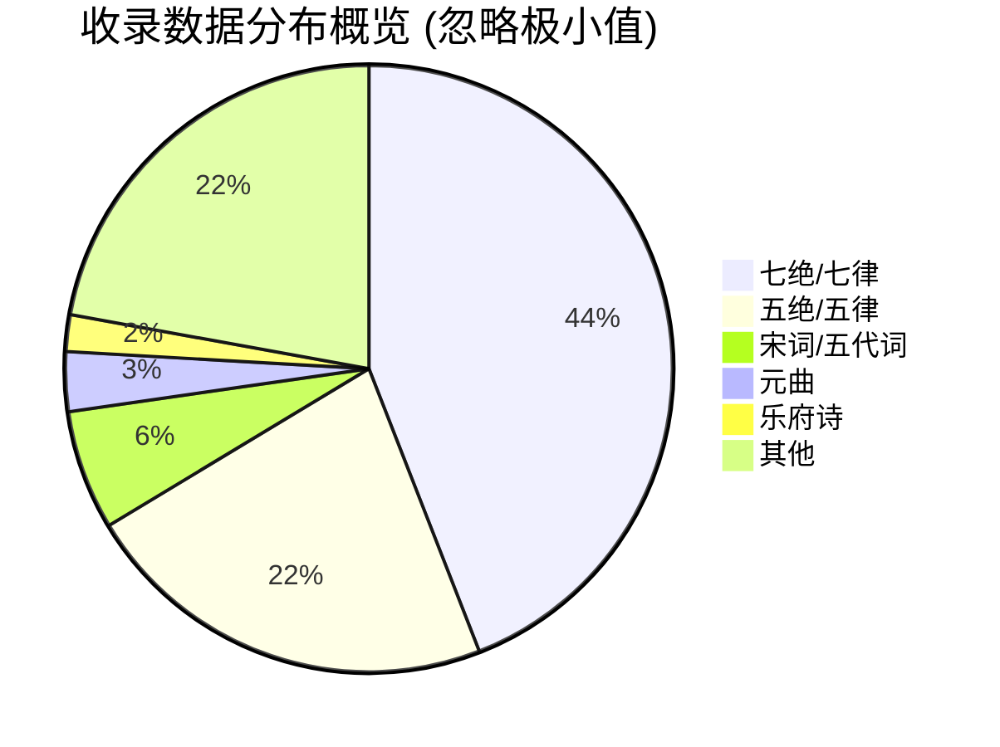

<div align="center">


<h2>中国古诗词 API 服务</h2>

[](https://hub.docker.com/r/palemoky/chinese-poetry-api)
[](https://hub.docker.com/r/palemoky/chinese-poetry-api)
[](https://github.com/pre-commit/pre-commit)
[](https://github.com/palemoky/chinese-poetry-api/blob/main/LICENSE)

基于 Go 语言的高性能中国古诗词 API 服务，支持 REST、GraphQL 和 MCP 接口，提供简体/繁体中文、爬虫练习场等功能。

在线版：https://poetry.palemoky.com

<a href="https://trendshift.io/repositories/69501?utm_source=repository-badge&amp;utm_medium=badge&amp;utm_campaign=badge-repository-69501" target="_blank" rel="noopener noreferrer"></a>

</div>

## 特性

- **高性能**: Go 语言编写，支持并发处理，性能优化（简繁转换 ~300ns/op）
- **海量数据**: 包含唐诗、宋词、元曲等近 40 万首诗词
- **强大搜索**: 支持全文搜索、标题/内容/作者分类搜索
- **双语支持**: 同一数据库同时存储简体和繁体中文，通过 `?lang=` 参数切换
- **多种接口**: 支持 REST API（附 OpenAPI 文档）、GraphQL 和 MCP
- **限流保护**: 内置 IP 限流，防止滥用
- **容器化**: Docker 镜像开箱即用，支持多架构（amd64/arm64）
- **智能分类**: 按朝代、作者、诗词类型自动分类

## 快速开始

### 使用 Docker（推荐）

```bash
docker run -d -p 1279:1279 palemoky/chinese-poetry-api:latest
```

完整配置参见 [docker-compose.yml](docker-compose.yml)。

### 使用 Makefile

```bash
make help          # 查看所有可用命令
make build         # 构建项目
make process-data  # 处理数据
make run-server    # 启动服务
make test          # 运行测试
```

搜索依赖 SQLite 的 FTS5 扩展，需要带 `sqlite_fts5` 构建标签编译。Makefile 已经带上了；直接用 `go` 命令时要自己加，例如 `go test -tags sqlite_fts5 ./...`，否则会报 `no such module: fts5`。

### 克隆仓库

本项目使用 Git Submodules 管理诗词数据，推荐使用以下命令快速克隆：

```bash
# 完整克隆（包含 submodules）
git clone --recurse-submodules --depth=1 https://github.com/palemoky/chinese-poetry-api.git
```

如果已经克隆了仓库，可以单独更新 submodules：

```bash
git submodule update --init --depth 1
```

## API 使用

### 多语言支持

所有接口支持 `lang` 参数切换简繁体：

|  参数值   |       说明       |
| :-------: | :--------------: |
| `zh-Hans` | 简体中文（默认） |
| `zh-Hant` |     繁体中文     |

### REST API

```bash
# 健康检查
curl "http://localhost:1279/api/v1/health"

# 统计信息
curl "http://localhost:1279/api/v1/stats"

# 简体中文（默认）
curl "http://localhost:1279/api/v1/poems"

# 繁体中文
curl "http://localhost:1279/api/v1/poems?lang=zh-Hant"

# 诗词列表（带过滤，与 /poems/random 使用同一组参数）
curl "http://localhost:1279/api/v1/poems?dynasty=唐"
curl "http://localhost:1279/api/v1/poems?author=李白&page=2&page_size=50"
curl "http://localhost:1279/api/v1/poems?dynasty_id=1&type_id=11&type_id=12" # 多个 type_id 为「或」关系

# 游标翻页：把上一页 pagination.next_cursor 的值回传给 after。
curl "http://localhost:1279/api/v1/poems?page_size=50&after=cG9lbTo0MjA"

# 搜索诗词，结果按相关度排序
curl "http://localhost:1279/api/v1/poems/search?q=静夜思"

# 在某个朝代内搜索（也可用 dynasty_id），排序与不限朝代时一致
curl "http://localhost:1279/api/v1/poems/search?q=月&dynasty=唐"

# 按意思检索（需启用语义检索，见下文）
curl "http://localhost:1279/api/v1/poems/semantic?q=下雪天一个老人独自在小船上钓鱼&limit=10"

# 随机诗词
curl "http://localhost:1279/api/v1/poems/random"

# 随机诗词（带过滤）
curl "http://localhost:1279/api/v1/poems/random?author=李白"
curl "http://localhost:1279/api/v1/poems/random?type=五言绝句"
curl "http://localhost:1279/api/v1/poems/random?type=唐诗&dynasty=唐" # 「唐诗」等分类名涵盖整个分类（五言绝句、七言律诗等），不限朝代
curl "http://localhost:1279/api/v1/poems/random?char=春" # 飞花令等单字场景
curl "http://localhost:1279/api/v1/poems/random?author=李白&type=五言绝句"
curl "http://localhost:1279/api/v1/poems/random?author=李白&type=五言绝句&dynasty=唐"
curl "http://localhost:1279/api/v1/poems/random?author=李白&dynasty=唐&type=五言绝句&type=七言绝句&type=五言律诗"

# 作者列表
curl "http://localhost:1279/api/v1/authors?page=1&page_size=20"

# 作者详情
curl "http://localhost:1279/api/v1/authors/1"

# 朝代列表
curl "http://localhost:1279/api/v1/dynasties"

# 朝代详情
curl "http://localhost:1279/api/v1/dynasties/1"

# 诗词体裁列表
curl "http://localhost:1279/api/v1/types"

# 诗词体裁详情
curl "http://localhost:1279/api/v1/types/10"
```

完整的接口说明见 OpenAPI 3.2 文档：`http://localhost:1279/api/v1/openapi.yaml`。可以导入 Swagger UI、Postman、Apifox，或者用 openapi-generator 生成各语言的客户端。

### GraphQL API

端点：`http://localhost:1279/graphql`

```graphql
# 繁体中文查询
query {
  poems(lang: ZH_HANT, pageSize: 10) {
    edges {
      node {
        title
        content
        author {
          name
        }
      }
    }
    totalCount
  }
}

# 搜索诗词
query {
  searchPoems(query: "静夜思", searchType: TITLE) {
    edges {
      node {
        title
        author {
          name
        }
      }
    }
  }
}

# 按意思检索（需启用语义检索）
query {
  semanticSearchPoems(query: "夜里船停在苏州城外，听见寺庙的钟声", limit: 5) {
    title
    author {
      name
    }
  }
}

# 统计信息
query {
  statistics {
    totalPoems
    totalAuthors
    poemsByDynasty {
      dynasty {
        name
      }
      count
    }
  }
}
```

### MCP

端点：`http://localhost:1279/mcp`（Streamable HTTP，无状态）

大模型客户端可以通过 [Model Context Protocol](https://modelcontextprotocol.io) 直接查询诗词，例如在 Claude Code 中添加：

```bash
claude mcp add --transport http poetry http://localhost:1279/mcp
```

| 工具 | 说明 |
|------|------|
| `search_poems` | 按字面子串搜索标题、正文或作者，可限定朝代，结果按相关度排序 |
| `list_poems` | 按作者、朝代、体裁筛选诗词 |
| `random_poem` | 随机一首诗词，可限定条件或指定包含某字 |
| `get_author` | 按姓名查询作者小传与作品数 |
| `get_statistics` | 查询总量及可用的朝代、体裁 |
| `search_poems_by_meaning` | 按意思检索，返回约 30 首候选供模型挑选；仅在启用语义检索时提供 |

所有工具都是只读的，并共用服务的 IP 限流。工具一律按名称访问数据，结果中不含 ID，因为 ID 在数据更新后可能变化。`search_poems` 是字面匹配，名称需要与 `lang` 选择的简繁写法一致。

## 搜索功能

|   类型    |       说明       |             示例             |
| :-------: | :--------------: | :--------------------------: |
|   `all`   | 全文搜索（默认） |           `?q=月`            |
|  `title`  |     标题搜索     |    `?q=静夜思&type=title`    |
| `content` |     内容搜索     | `?q=床前明月光&type=content` |
| `author`  |     作者搜索     |    `?q=李白&type=author`     |

搜索按子串匹配，结果按相关度排序：标题与查询完全相同的排在最前，搜词牌名（如“声声慢”）时“声声慢·寻寻觅觅”也算完全相同；其次是标题包含、作者名、正文包含。收在《唐诗三百首》《千家诗》《宋词三百首》里的名篇另外加分，所以搜“声声慢”时李清照那首排在第一。分数相同时按 ID 排序，`content` 类型的结果都按 ID 排序。

## 语义检索（可选）

语义检索可以用白话、英文描述或记不全的句子找诗，例如“夜里船停在苏州城外，听见寺庙的钟声”能找到《枫桥夜泊》。它把查询向量与每首诗的向量比较，再与关键词搜索的结果融合，名篇另外加分。效果与取舍见 [评测](eval/semantic/README.md)。

启用需要两样东西，缺一样时服务照常运行，只是不提供这项功能：

1. **向量文件** `poetry-vectors.db`：随数据一起发布为 `poetry-vectors.db.zst`（约 200MB），放在主库旁边（默认 `data/poetry-vectors.db`，可用 `VECTORS_PATH` 指定）。它必须与主库来自同一次发布，否则服务拒绝加载。用 Docker 时不必手动下载：配置了 `EMBEDDING_API_URL` 后，容器启动时会下载与数据库配套的向量文件，并随数据库一起更新。

   也可以自己生成，在 Apple M 系列芯片上约需 2 小时，中断后可以续跑：

   ```bash
   ollama pull bge-m3
   go run -tags sqlite_fts5 ./cmd/processor embed --db data/poetry.db -o data/poetry-vectors.db
   ```

2. **嵌入接口**：用同一个模型把查询转成向量，任何 OpenAI 兼容的 `/embeddings` 接口都可以。用本机的 Ollama：

   ```bash
   ollama pull bge-m3
   EMBEDDING_API_URL=http://localhost:11434/v1   # 容器内访问宿主机用 http://host.docker.internal:11434/v1
   ```

   改用云服务时，用 `EMBEDDING_MODEL` 指定它对这个模型的叫法，用 `EMBEDDING_API_KEY` 传密钥。例如[硅基流动](https://siliconflow.cn)：接口 `https://api.siliconflow.cn/v1`，模型 `BAAI/bge-m3`（免费）或 `Pro/BAAI/bge-m3`（付费）。不同服务部署的模型未必完全一致，启用前先确认它产生的向量与向量文件相同：

   ```bash
   EMBEDDING_API_KEY=... go run -tags sqlite_fts5 ./cmd/processor check-embeddings \
     --db data/poetry.db --vectors data/poetry-vectors.db \
     --api https://api.siliconflow.cn/v1 --model BAAI/bge-m3 --api-key-env EMBEDDING_API_KEY
   ```

发布数据时，CI 会复用上一版的向量，只把改动过的诗交给硅基流动嵌入，需要在仓库中配置 `SILICONFLOW_API_KEY`；未配置时只发布数据库。

启用后，服务启动时多花约 2 秒载入向量，常驻内存增加约 350MB。每次检索约 30ms，另加一次嵌入请求的耗时。REST 接口 `/api/v1/poems/semantic` 与 GraphQL 查询 `semanticSearchPoems(query, lang, limit)` 都不分页，用 `limit` 指定条数（默认 20，最多 50）。未启用时 REST 返回 503、GraphQL 返回错误；嵌入接口出错时 REST 返回 502。

## 数据集

本项目基于 [chinese-poetry](https://github.com/chinese-poetry/chinese-poetry) 数据集，使用的是修正了错字、朝代与作者等问题的 [palemoky/chinese-poetry](https://github.com/palemoky/chinese-poetry)（`fix-typo` 分支），包含：

|   分类   |  数量  |   分类   |  数量  |   分类   |  数量  |   分类   |  数量  |
| :------: | :----: | :------: | :----: | :------: | :----: | :------: | :----: |
| 五言绝句 | 16,860 | 七言绝句 | 82,744 | 五言律诗 | 59,681 | 七言律诗 | 68,696 |
|  乐府诗  | 6,714  |  五代词  |  543   |   宋词   | 21,347 |   元曲   | 10,904 |
|   诗经   |  305   |   楚辞   |   65   |   论语   |   20   | 四书五经 |   14   |
|   其他   | 76,077 |          |        |          |        |          |        |



## 致谢

- 数据来源：[chinese-poetry](https://github.com/chinese-poetry/chinese-poetry)
- 简繁转换：[gocc](https://github.com/liuzl/gocc)
